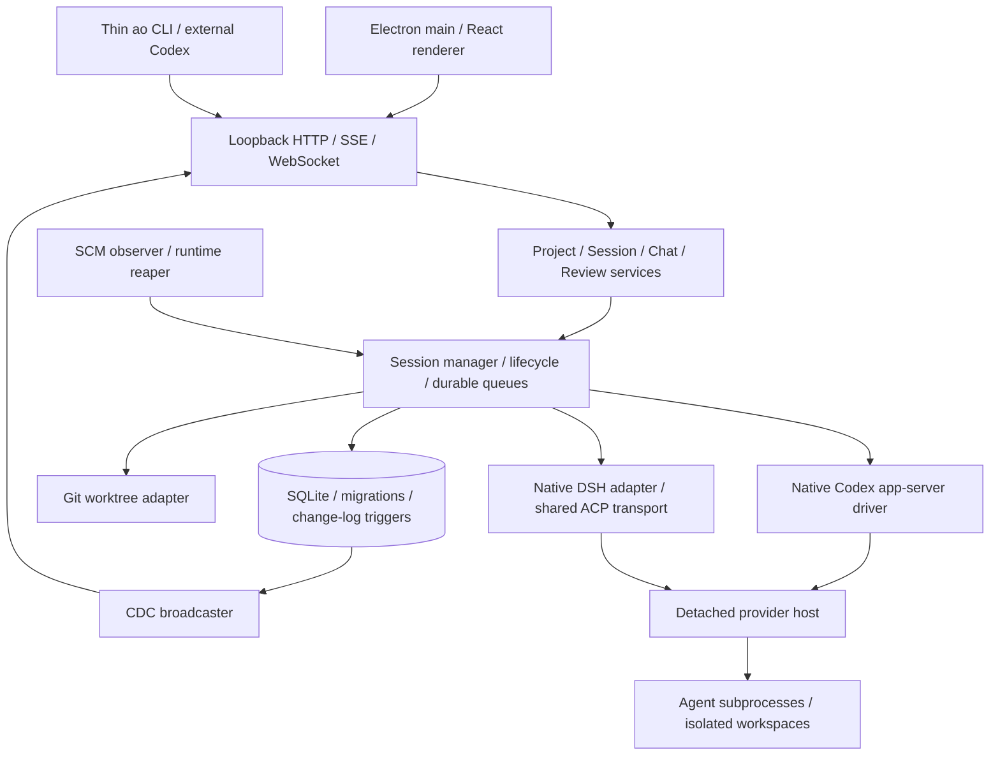

# Fixed-baseline source audit

Audit target: `b325d24b741297bf89296e76501d7e09018c4a04`.
Conclusions below come from implementation and bundled documentation, not just
the upstream README. Installed-agent compatibility still requires live tests.

## Architecture

`frontend/src/main.ts` owns Electron, daemon supervision and profile locations.
The React renderer uses the generated API client; business policy belongs in
the daemon. `packages/product-ui` supplies shared visual components. Cloud
contracts are present, but the private cloud control plane is absent.

Go boundaries: `internal/cli` → `httpd/controllers` → `service` → ports and
adapters. `internal/session_manager` provisions controllers and workspaces;
`internal/lifecycle` reacts to observed facts. `internal/storage/sqlite`
contains migrations, SQL query sources, generated sqlc code and stores.
SQLite persists project config, sessions, conversations, messages, queues,
review/PR facts, transitions and change events. Display status is derived, not
a second persisted state machine.

## Codex control and reviews

`domain/projectconfig.go` already separates Worker, Orchestrator and Reviewers.
Codex uses native app-server. An empty reviewer list for a DSH worker can fall
back to Claude Code; explicitly configure Codex rather than relying on defaults.

`service/session/delegation.go` currently creates workers directly from desktop
tasks. `session_manager/manager.go` seeds CI/review auto-injection, while
`lifecycle/reactions.go` can send rework directly to workers (including conflict
nudges). These bypass the requested Codex decision boundary. CLI, desktop and
automation must share daemon-side policy; hiding UI controls is insufficient.
`review trigger --no-inject` does not necessarily reset a prior true setting.

Keep an independent project control revision, atomically compare it on dispatch,
and persist ownership outside the replaceable project-config JSON. Takeover
must fence old dispatch without terminating workers. This is workflow control
for trusted same-user clients, not isolation from hostile local processes.

Native PR review is available, but is tied to a tracked PR and may post GitHub
comments. It is not a no-PR local review or a GitHub approval. Underlying
`ports.ChatControllerStart.ReadOnly`, `ports.ChatStartConfig.ReadOnly` and
`codexappserver/driver.go` already support `never` approval plus `read-only`
sandbox. Public session spawning does not persist this constraint. Add that
property end to end; enforce it at creation, recovery and setting/controller
changes. Initially allow Codex Chat only. Bind review evidence to worker and
base/head commits; invalidate conclusions after new commits.

## DSH integration

`adapters/chatdriver/deepseekharnessacp/driver.go` uses the existing native ACP
transport and launches the discovered binary with `--profile acp`. Model values
are opaque catalog values; reasoning effort maps to off/low/high/max. Standing
instructions are prepended on the first turn. No bridge is needed.

DSH Chat and headless are different paths. Headless success cannot establish
ACP compatibility. ACP does not support extra repository directories; retain
the one-repository limit. Native resume does not replay history, so preserve
the daemon's transcript and recovery machinery.

Potential version mismatch: accept-edits relies on the permission request's
tool kind. Some DSH versions send only the tool ID. A missing kind must request
human approval, never silently grant it. Reproduce with the installed version
before patching shared metadata handling. Unknown tools remain unapproved.

## Windows and recovery

ConPTY, Windows subprocess helpers and worktree support already exist. Verify
`.cmd` launch through the actual driver, UTF-8/Chinese and spaced paths, long
paths, file locks and detached-host reconnect. Partial upstream Windows CI is
not product-level evidence. Native race testing also needs the supported C
toolchain; record availability explicitly.

Detached hosts, generations, durable queue acknowledgement/replay and
idempotency already exist. Startup interruption may leave a failed session with
retryable work; do not promise universal transparent continuation. An unknown
runtime probe is not proof of death. Dirty worktrees must not be force-deleted.

## Change map and reuse

| Area | Reuse | Required extension |
|---|---|---|
| Projects | existing config, registry, permission policy | Codex/DSH defaults and one-controller policy |
| Tasks | sessions, idempotent spawn, queues, logs | consistent intake and fenced dispatch |
| Agents | Codex app-server and DSH native ACP | installed-version fixes only if reproduced |
| Reviews | conversations, reports, cancellation, restore | durable read-only local review binding |
| Recovery | hosts, transitions, persisted facts | tests for takeover and interrupted evidence sync |
| Workspaces | Git worktrees and safe cleanup | Windows compatibility validation |
| Desktop | Electron/React and existing components | names, artwork, theme and local-only surfaces |
| Packaging | existing Forge build | app/protocol/install IDs, isolated roots, no upstream updater |

Likely owning sources: `domain/projectconfig.go`, `ports/session.go`,
`service/session`, `service/project`, `service/chat`, `session_manager`,
`lifecycle/reactions.go`, HTTP DTO/controller/operation registry, CLI commands,
new SQLite migrations/queries, `frontend/src/main.ts`, `frontend/forge.config.ts`
and relevant renderer entry/settings components. Regenerate OpenAPI and sqlc
artifacts from their sources; do not manually patch generated files.

## Main risks

- Dual dispatch if ownership check and reservation are not atomic.
- Old review conclusions surviving a changed head or uncommitted edits.
- Permission escalation on resume, harness/mode switch, or unknown ACP tools.
- Duplicate work after an uncertain result; query/recover before retrying.
- Shared `.ao`/Electron profiles, protocol handlers or installer identities.
- Upstream update, telemetry or cloud defaults accidentally remaining active.
- GitHub authentication, signing credentials and external services are separate
  release dependencies, not proof of source defects.
