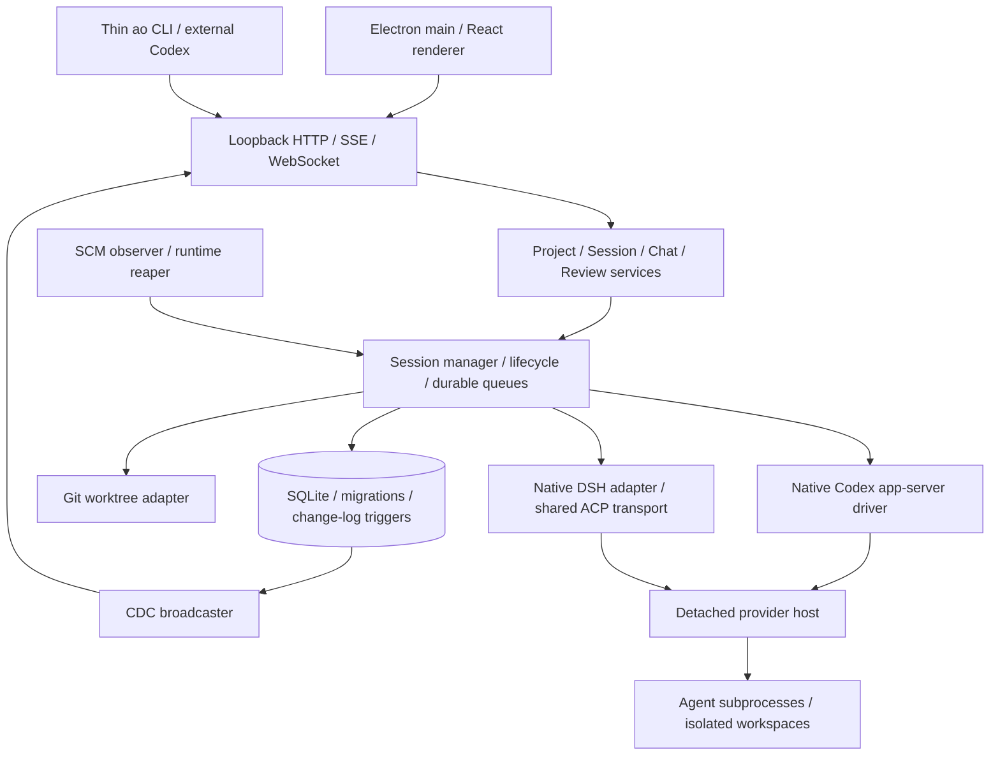

# Fixed-baseline source audit

Audit target: `b325d24b741297bf89296e76501d7e09018c4a04`.
Conclusions below come from implementation, bundled documentation and current
official documentation, not just the upstream README. The architecture describes
the fixed upstream baseline; fork changes and live results are tracked separately
in [validation](validation.md).

## Architecture

`frontend/src/main.ts` owns Electron, daemon supervision and profile locations.
The React renderer uses the generated API client; business policy belongs in
the daemon. `packages/product-ui` supplies shared visual components. Cloud
contracts are present, but the private cloud control plane is absent.

Go boundaries: `internal/cli` → `httpd/controllers` → `service` → ports and
adapters. `internal/session_manager` provisions controllers and workspaces;
`internal/lifecycle` reacts to observed facts. `internal/storage/sqlite`
contains migrations, SQL query sources, generated sqlc code and stores.
SQLite persists project config, sessions, conversations, messages, queues,
review/PR facts, transitions and change events. Display status is derived, not
a second persisted state machine.

### Owning modules

| Layer | Source | Responsibility |
|---|---|---|
| Desktop process | `frontend/src/main.ts`, `frontend/src/preload.ts` | Windows, IPC boundary, daemon supervision, Electron state |
| Desktop integration | `frontend/src/shared/daemon-{launch,discovery,attach}.ts` | Discover and attach to the daemon; reuse existing discovery |
| Renderer | `frontend/src/renderer/routes`, `components`, `hooks`, `stores` | Project/task views, conversations, UI state and subscriptions |
| API contract | `backend/internal/httpd/controllers/dto.go`, `httpd/apispec`, `frontend/src/api/schema.ts` | Code-first HTTP DTOs, generated OpenAPI and frontend types |
| Shared UI | `packages/product-ui`, `frontend/src/styles/tokens.css` | Existing components and theme tokens for later branding |
| Session policy | `backend/internal/service/session`, `session_manager` | Spawn, delegation, workspace/controller lifecycle and recovery |
| Conversation policy | `backend/internal/service/chat` | Turn delivery, queues, approvals, history, branches and side conversations |
| Feedback/review | `backend/internal/lifecycle`, `service/review`, `service/pr`, `service/report` | CI/PR facts, reactions and reports; worker nudges need controller gating |
| Agent engines | `backend/internal/adapters/chatdriver`, `adapters/agent` | Native protocols, binary/auth discovery and harness capabilities |
| Workspaces | `backend/internal/adapters/workspace/gitworktree` | Git worktree creation, observation and safe removal |
| Runtime | `adapters/chatdriver/persistenthost`, `adapters/runtime/conpty` | Detached Chat hosts and native Windows terminal processes |
| Persistence | `backend/internal/storage/sqlite/{migrations,queries,gen,store}` | Durable facts, sqlc queries and trigger-backed changes |

### SQLite data relationships

The initial schema alone is insufficient: later migrations add and replace
conversation/review tables. Current query sources and generated models are the
read/write contract. Important durable relationships are:

- `projects` → `sessions`; project configuration selects role-specific agents.
- `workspace_repos` / `session_worktrees` associate repository/workspace facts
  with sessions. Git remains the source for commits and worktree contents.
- `conversations` → `conversation_branches`, `conversation_turns`,
  `conversation_messages`, `conversation_activities` and provider events.
  Turn delivery/recovery is distinct from display status.
- `review`, `review_run`, PR review/comment facts and reviewer conversations
  represent the existing PR review flow; they do not implement local commit-bound
  acceptance by the main controller.
- `session_interface_transitions` and transition messages persist interface
  handoffs; queued edit/steer delivery tables retain uncertain delivery facts.
- `change_log` is populated by SQL triggers and feeds UI updates. New session
  properties should use this existing event path.

The fork adds one new migration for `sessions.read_only`; it does not rewrite
any upstream migration or add another task state machine.

## Codex control and reviews

`domain/projectconfig.go` already separates Worker, Orchestrator and Reviewers.
Codex uses native app-server. An empty reviewer list for a DSH worker can fall
back to Claude Code; explicitly configure Codex rather than relying on defaults.

`service/session/delegation.go` currently creates workers directly from desktop
tasks. `session_manager/manager.go` seeds CI/review auto-injection, while
`lifecycle/reactions.go` can send rework directly to workers (including conflict
nudges). These bypass the requested Codex decision boundary. CLI, desktop and
automation must share daemon-side policy; hiding UI controls is insufficient.
`review trigger --no-inject` does not necessarily reset a prior true setting.

Keep an independent project control revision, atomically compare it on dispatch,
and persist ownership outside the replaceable project-config JSON. Takeover
must fence old dispatch without terminating workers. This is workflow control
for trusted same-user clients, not isolation from hostile local processes.

Native PR review is available, but is tied to a tracked PR and may post GitHub
comments. It is not a no-PR local review or a GitHub approval. Underlying
`ports.ChatControllerStart.ReadOnly`, `ports.ChatStartConfig.ReadOnly` and
`codexappserver/driver.go` already support `never` approval plus `read-only`
sandbox. Public session spawning does not persist this constraint. Add that
property end to end; enforce it at creation, recovery and setting/controller
changes. Initially allow Codex Chat only. Bind review evidence to worker and
base/head commits; invalidate conclusions after new commits.

## DSH integration

`adapters/chatdriver/deepseekharnessacp/driver.go` uses the existing native ACP
transport and launches the discovered binary with `--profile acp`. Model values
are opaque catalog values; reasoning effort maps to off/low/high/max. Standing
instructions are prepended on the first turn. No bridge is needed.

DSH Chat and headless are different paths. Headless success cannot establish
ACP compatibility. ACP does not support extra repository directories; retain
the one-repository limit. Native resume does not replay history, so preserve
the daemon's transcript and recovery machinery.

Potential version mismatch: accept-edits relies on the permission request's
tool kind. Some DSH versions send only the tool ID. A missing kind must request
human approval, never silently grant it. Reproduce with the installed version
before patching shared metadata handling. Unknown tools remain unapproved.

## Windows and recovery

ConPTY, Windows subprocess helpers and worktree support already exist. Verify
`.cmd` launch through the actual driver, UTF-8/Chinese and spaced paths, long
paths, file locks and detached-host reconnect. Partial upstream Windows CI is
not product-level evidence. Native race testing also needs the supported C
toolchain; record availability explicitly.

Detached hosts, generations, durable queue acknowledgement/replay and
idempotency already exist. Startup interruption may leave a failed session with
retryable work; do not promise universal transparent continuation. An unknown
runtime probe is not proof of death. Dirty worktrees must not be force-deleted.

## Change map and reuse

| Area | Reuse | Required extension |
|---|---|---|
| Projects | existing config, registry, permission policy | Codex/DSH defaults and one-controller policy |
| Tasks | sessions, idempotent spawn, queues, logs | consistent intake and fenced dispatch |
| Agents | Codex app-server and DSH native ACP | installed-version fixes only if reproduced |
| Reviews | conversations, reports, cancellation, restore | durable read-only local review binding |
| Recovery | hosts, transitions, persisted facts | tests for takeover and interrupted evidence sync |
| Workspaces | Git worktrees and safe cleanup | Windows compatibility validation |
| Desktop | Electron/React and existing components | names, artwork, theme and local-only surfaces |
| Packaging | existing Forge build | app/protocol/install IDs, isolated roots, no upstream updater |

Likely owning sources: `domain/projectconfig.go`, `ports/session.go`,
`service/session`, `service/project`, `service/chat`, `session_manager`,
`lifecycle/reactions.go`, HTTP DTO/controller/operation registry, CLI commands,
new SQLite migrations/queries, `frontend/src/main.ts`, `frontend/forge.config.ts`
and relevant renderer entry/settings components. Regenerate OpenAPI and sqlc
artifacts from their sources; do not manually patch generated files.

## Main risks

- Dual dispatch if ownership check and reservation are not atomic.
- Old review conclusions surviving a changed head or uncommitted edits.
- Permission escalation on resume, harness/mode switch, or unknown ACP tools.
- Duplicate work after an uncertain result; query/recover before retrying.
- Shared `.ao`/Electron profiles, protocol handlers or installer identities.
- Upstream update, telemetry or cloud defaults accidentally remaining active.
- GitHub authentication, signing credentials and external services are separate
  release dependencies, not proof of source defects.

## Build and test boundaries

Root `package.json` delegates frontend typechecking, API generation and sqlc.
`frontend/package.json` builds the daemon, browser extension, packaged browser
runtime and ACP Node runtime before Electron Forge packaging. The Windows maker
is `frontend/makers/maker-nsis.ts`; native `better-sqlite3` must be rebuilt for
the pinned Electron version. A daemon build is not a desktop package test.

`.github/workflows/go.yml` runs Linux build/vet and partitioned race suites;
`frontend.yml` handles renderer/type checks and selected native checks;
`build-artifacts.yml` includes Windows packaging. This does not qualify all
Windows filesystem, permissions, process and recovery paths. The local baseline
suite has failures and the desktop build currently lacks the C++ toolchain;
see the validation ledger rather than assuming CI implies local success.

## Official documentation checked

Retrieved and checked on 2026-11-04 alongside the fixed source snapshot:

- [Orchestrator agent plugins](https://docs.orchestrator.inc/plugins/agents/):
  native DSH Chat launches `dsh --profile acp`; experimental reviewer prompts
  alone do not isolate filesystem/tools/network.
- [Orchestrator installation](https://docs.orchestrator.inc/installation/):
  desktop installation and agent/runtime prerequisites.
- [Codex configuration reference](https://developers.openai.com/codex/config-reference/):
  custom Responses providers, authentication requirements and Windows sandbox
  configuration. Keep the user's relay provider rather than forcing OAuth.
- [Codex on Windows](https://developers.openai.com/codex/windows/): native Windows
  execution and sandbox requirements. Availability of a documented mode does not
  prove its local setup succeeds.

Local documentation snapshots are validation evidence outside Git. The live
native protocol/schema and execution results determine compatibility; a new
upstream or CLI version requires a fresh comparison.
